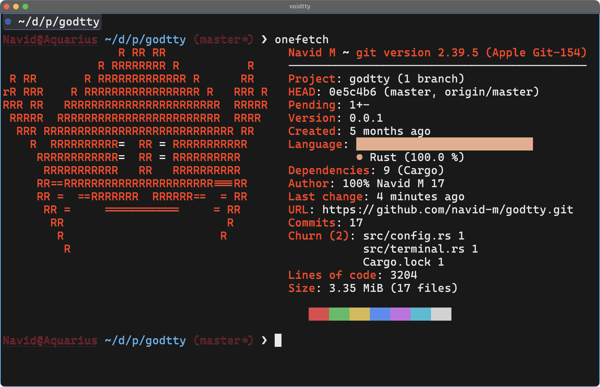
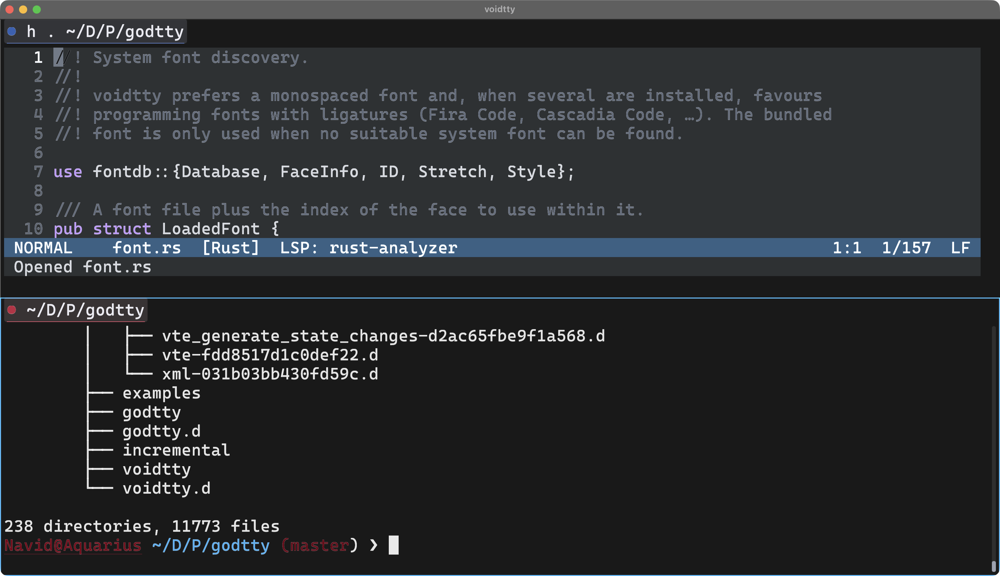

# voidtty

Simple terminal emulator for personal use.

- New horizontal pane: Ctrl+Shift+O
- New vertical pane: Ctrl+Shift+E
- New tab in current pane: Ctrl+Shift+T
- Close tab: Ctrl+Shift+W

---

---

By Navid Momtahen (C) - 2026

License: GPL-3.0-only
